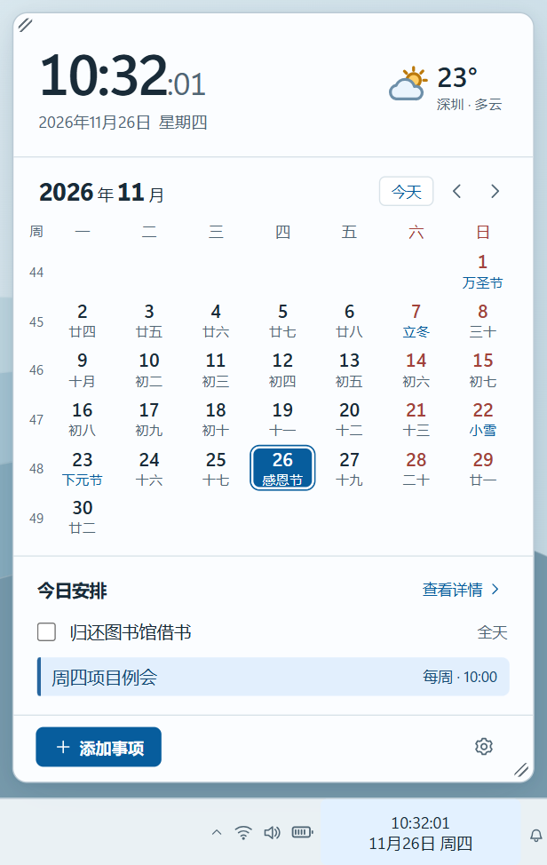

# YXRL · Windows 个人日历

点一下任务栏原来的时间，打开一张带农历、节气和休班标记的月历。点日期在左侧查看日详情，再点同一天收起。可点原型还可以看日程、勾选待办。界面为个人自用设计，无广告和会员入口。

**Windows 桌面试用**　双击发布目录中的 Yxrl.exe，左键点击任务栏原时间位置打开月历，点齿轮设置时钟。再次运行同一个 EXE 也可打开设置。[试用与打包说明](windows.md)

**体验原型**　下载或检出仓库后，保留 `prototype` 整个目录，双击 `index.html`。可以直接在离线的 Edge 或 Chrome 中操作。仓库网页会将 HTML 显示为源码。[打开本地原型](prototype/index.html)

**截图与翻译**　月历底栏「截图工具」可打开截图、贴图和粘贴文字翻译。从「截图与翻译」设置可改键并配置模型服务。[界面流程](ui-interactions.md#截图工具)

## 体验路径

1. 在左栏选「任务栏时钟」，再点击模拟任务栏右侧的时间。拖动月历左上角或右下角，观察日期格和字号随窗口变化。点击 11 月 26 日，在左侧看农历十月十八、感恩节和今日安排，再点同一天收起。新增一条待办，保存后勾选完成。
2. 点击月历天气，在「图标演示」切换晴天、日出、日落和降雨。选择「离线有缓存」或「离线无缓存」，可查看天气异常时的界面。
3. 在「节日管理 → 动态」搜索并关闭感恩节，再看月历、日详情和「节日节气」时钟。切到 2026 年 10 月，10 日仍显示「班」。
4. 打开「日历设置」，自定周数范围为 11 月 23 至 29 日。默认周一开头的月历只显示第 48 周；再切换周首日、12 小时制和日程配色查看联动。
5. 点亮月历图钉，再点击模拟桌面空白，检查月历仍可见。原型的「软件设置」也可体验托盘图标、隐私锁和待办完成音。

## 交付内容

| 入口 | 可以查到 |
| --- | --- |
| [项目架构](architecture.md) | 模块职责、数据归属、依赖方向、窗口生命周期、事项与提醒流程 |
| [模块配置](configuration.md) | 设置入口、九种时钟预设、格式字段、持久化示例、网络与开发配置 |
| [UI 规范](ui-spec.md) | 设计原则、色彩与字号令牌、对比度、尺寸、组件状态、无障碍 |
| [交互规范](interaction-spec.md) | 窗口状态流转、鼠标与键盘、事项与设置流程、焦点、反馈与错误、验收清单 |
| [界面与交互](ui-interactions.md) | 界面图、Windows 11 视觉规范、操作与业务状态的对应关系、验收步骤 |
| [可交互原型](prototype/index.html) | 在同一会话内切换时钟、日历和窗口设置，编辑事项、管理节日并模拟断网 |
| [项目协作规范](../AGENTS.md) | 项目定义、技术基线、验证和 Git 约定 |

## 当前阶段与数据

桌面试用版使用系统当前日期，支持原位时钟、月历、日详情、时钟配置和一次性日期提醒。浏览器原型固定演示日期为 **2026 年 11 月 26 日**，可翻阅 2026、2027 两个完整年份。左栏控制演示环境，刷新页面或选择「重置演示」恢复初始示例。三个城市的天气和两条初始事项均为本地样例。

历法快照由 `lunar-csharp` 1.6.9 生成，包含农历、干支、节气和宜忌；休班表来自国务院办公厅年度通知。桌面版使用同版本库实时计算历法，按当前用户保存设置。登录启动、辅助托盘、身份核验和重复事项提醒属于后续桌面功能。[历法库](https://www.nuget.org/packages/lunar-csharp/1.6.9) · [2026 年放假安排](https://www.beijing.gov.cn/zhengce/zhengcefagui/202511/t20251104_4258873.html) · [2027 年放假安排](https://www.dxh.gov.cn/ZWGK/zc_zwgk/ZFWJ/TZGG/202611/t20261106_2875104.shtml)
