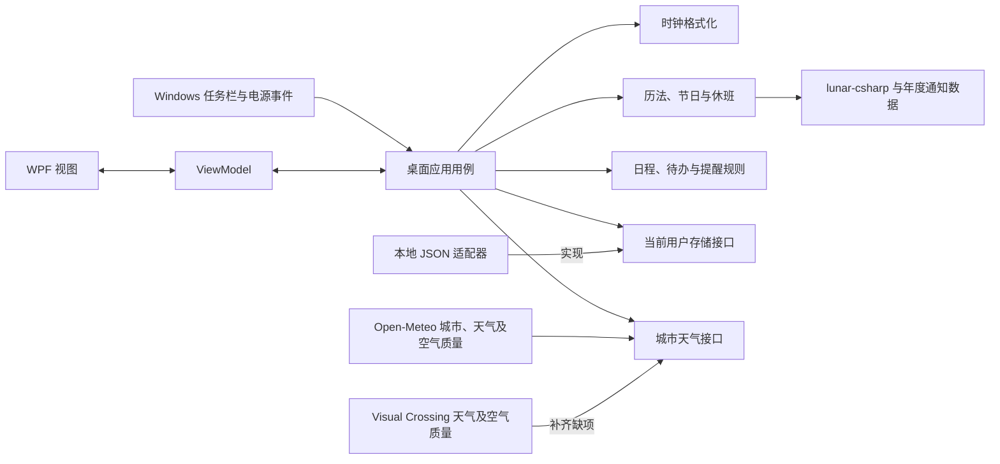
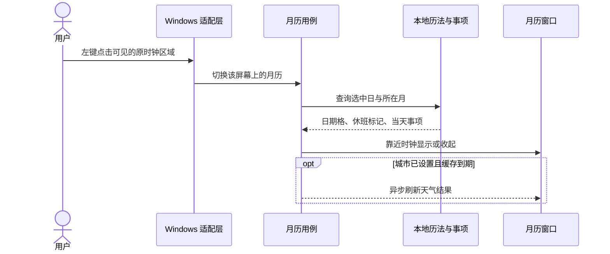
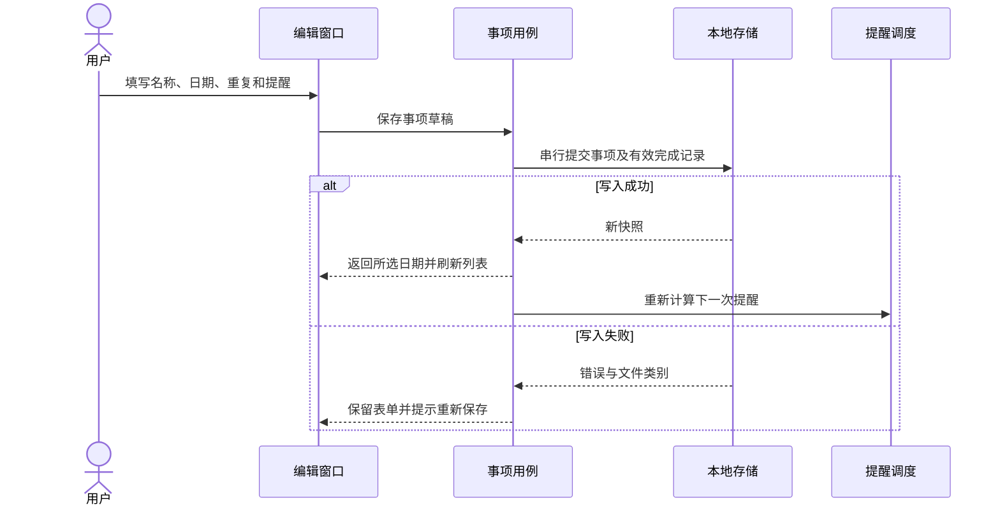

# 项目架构

YXRL 的桌面版本按单进程 Windows 应用设计。平时只需要时钟和到点提醒工作，点击任务栏时间才创建或显示月历。浏览器原型实现页面交互和可复算的日期示例；首个 WPF 试用版已实现时钟、月历、配置和 Windows 适配层。[桌面试用与源码构建](windows.md)。[可交互原型](prototype/index.html) · [字段与默认值](configuration.md)

## 模块与数据归属

| 模块 | 拥有的数据与职责 | 交给调用方的结果 |
| --- | --- | --- |
| Windows 桌面与任务栏 | 单实例生命周期、可见系统时钟的实际边界、显示器 DPI、指针命中、开合和焦点 | 时钟区域及其所在屏幕、打开或收起请求、桌面或电源变化 |
| 界面与应用用例 | 月份、选中日期、设置草稿、正在编辑的事项。WPF View 绑定 ViewModel，命令执行保存、切月、开关节日等操作 | 月历、日详情、任务栏文字、表单状态和可读错误 |
| 软件偏好与窗口行为 | 登录启动意向、托盘图标、关闭策略、可恢复的位置、隐私锁和完成提示音 | 由 Windows 适配层执行的当前用户操作，或有提示的失败状态 |
| 月历显示偏好 | 日期格第二行、邻月日期、滚动对齐、周首日、ISO 周显示区间、天气开关和事项配色 | 同一组选中日与事项在当前显示参数下的视图模型 |
| 时钟格式化 | 九种预设、自定义字段和两行文字排版。设置预览、任务栏共同调用相同格式器 | 两行完整内容；空间不足时的固定时间和分段内容 |
| 历法与节日 | 公农历转换、节气、干支、宜忌，公历／农历／动态节日规则，按年的官方休班表 | 指定日期的历法信息、已启用节日集合、独立的休班标记 |
| 日程与待办 | 事项起始日期、时间、重复规则、按发生日期记录的待办完成状态 | 某日实际发生的事项，或选定系列的变更 |
| 提醒 | 当前本地时钟、到期计算、最近检查点、已处理的发生记录 | 下一次到期时间、一次本机提醒意图 |
| 天气 | 城市搜索、天气与空气质量两路请求，按地点及来源时间维护缓存 | 当前、缓存、缺少数据三种结果及各自时间 |
| 本地存储 | 当前用户的数据目录、文件版本、读写串行化、失败恢复 | 已提交快照或可识别的读写错误 |

`农历日期`是某个公历日的历法属性。`节日规则`描述每年何时出现一个名称，`节日实例`是它在某个具体日期的出现。`休班标记`来自年度通知，其中「休」表示通知明确的假期，「班」表示调休上班。普通周末用周末色表达。关闭「国庆节」这个名称后，十月的休班安排继续生效。

`日程`表示一个安排，`待办`有可勾选的完成状态。一个每周待办只保存一个系列；本周四完成后，下周四仍待完成。`提醒实例`用事项标识和发生日期定位，并记录该次计划提醒时间。

## 依赖方向

用例先取本地历法与事项，生成可显示的月历。天气缓存可读时一起显示。选定城市后，气温和美标 AQI 并行刷新，各自在取得有效结果时更新界面和缓存。主源失败或等待满 3 秒时，本轮尚缺的数据共用一次备用查询。切换城市会取消旧请求，已经取得的结果保留在原城市。

WPF 源码中，`Desktop/ClockLocator.cs` 在后台识别 Explorer 控件，`Desktop/ClockMouse.cs` 在独立消息线程处理已确认时钟边界内的左键。Windows 11 25H2 的部分系统按钮共用 UIA 类名，识别时还会检查原始树中的时间和日期文本。`Views/ClockOverlay.cs` 将格式器输出排进原时钟的可用宽高，根据实际折行后的高度选择字号。月历和日详情通过 `MonthViewModel` 与 `CalendarService` 查询日期。

## 点击系统时间

日详情是月历的附属窗，跟随月历左边缘定位。两窗共用选中日期、置顶状态和自动收起计时。鼠标停在任一窗上都会重置离开计时。

Windows 适配层在普通用户进程中，用 UI Automation 识别 Explorer 原生日期、时间控件，缓存物理像素矩形，再按目标显示器 DPI 转换成 WPF 尺寸。独立的无激活绘制窗口贴合该区域，左键命中时切换月历。视觉层对其他指针操作透传，使时钟右键与相邻通知、网络、音量等系统操作仍由 Windows 处理。桌面版本需单独实测命中与窗口层级。[微软 UI Automation 坐标说明](https://learn.microsoft.com/en-us/dotnet/framework/ui-automation/ui-automation-and-screen-scaling) · [Win32 分层窗口与指针命中](https://learn.microsoft.com/en-us/windows/win32/winmsg/window-features)

覆盖窗口紧贴任务栏的窗口层级，绘制由实时边界驱动。任务栏滑入、滑出时，按上次测得的相对位置移动覆盖层，并裁剪到屏幕内。收起时隐藏覆盖层并释放鼠标命中区域，展开时复用窗口和位置。Explorer 重建、任务栏尺寸或 DPI 改变时重新测量。退出应用后销毁自有窗口、解除回调。再次启动同一程序时由当前用户的现有实例打开界面。

Windows 版的月历浮窗与设置窗口各自布局。月历齿轮和重复启动共用一个设置窗口，激活已打开的窗口会保留草稿。九张样式卡、底部实际预览和任务栏调用同一个时钟格式器。固定示例使用独立的内置节日与样例天气。显示当前时间时复用用户历法和天气缓存，每秒只更新变化的文字。

本机调研时，原时间位置已有优效的时钟控件。正式验收时按约定正常退出优效，实测系统时钟位置、仅一次弹窗、悬停和右键、相邻按钮、缩放及退出恢复。测完重新打开优效。

## 窗口偏好、隐私和命令行

未固定时，月历用单调时钟累计指针连续离开时长，满 5 秒收起。任务栏鼠标监听在需要时把普通点击的位置交给月历判断，点击仍交给 Windows 的目标窗口。固定时两窗置顶并暂停自动收起。原型按联动关闭开关决定是否保留已打开的设置窗口。启用隐私锁时先收起个人内容，解锁成功后进入请求的页面。

原生登录启动是当前用户的可选配置。用户打开开关后才注册应用自己的启动项，关闭时仅撤销自己注册的条目。辅助托盘图标根据设置创建或删除，点击它与点击主时钟共用开合命令。记忆位置保存屏幕标识及工作区相对位置，在 DPI 改变、屏幕断开或回到单屏时重新约束到可见范围。

桌面版隐私锁采用当前 Windows 用户的系统身份验证；系统验证不可用时说明原因、保留锁定状态。锁定时任务栏仅显示一般时间与日期，提醒使用不透露标题的提示。原型使用仅在页面内存保留的演示 PIN 验证值，刷新后清空。待办从未完成切到完成且持久化成功后才产生提示音；撤销完成与重复渲染均保持安静。

桌面 CLI 是同一个事项应用用例的第二个入口。未显式指定分类的新增日程读取 CLI 默认日历分类，显式参数优先。原型的「试建命令行示例日程」通过同一个保存处理提交到演示清单。正式命令行需在 WPF 版本验证进程通信与读回。

## 保存事项与提醒

Windows 版的右键日期提醒由 `ReminderStore` 保存，`ReminderDelivery` 每秒在应用调度线程检查到期时间。保存表单、删除和写送达记录通过同一份内存快照与原子文件提交串行执行。月历与设置关闭后，提醒调度继续运行。恢复运行时合并尚未送达的到期提醒，先保存收据，再显示 `ReminderPopup`。提醒弹框显示标题、事项时间和提前量，出现时保持当前窗口的焦点。

以下为完整日程、待办和重复事项的流程设计。

按日期惰性展开重复事项。修改重复事项时，编辑器明确作用于整个系列；保存后保留仍然有效的待办完成日期。删除系列会一起清理对应的完成状态与待触发提醒。勾选完成仅修改当前日期的发生记录。

桌面端在启动、唤醒、时间变更或事项变更后重排到期队列。相同发生记录只发出一次提醒，同步到期的多条事项可以合并展示；已完成的待办跳过。唤醒回看上次检查到当前之间的到期事项，长期离线时同一系列仅补最近一次，并标明原定时间。用单实例调度和持久化收据防止正常重启、唤醒重复弹出。若进程在写入收据与显示通知之间崩溃，收据优先，避免重播；用户仍可在日详情查到事项。

## 状态保存与原型对应

桌面版以当前用户目录为边界。配置、个人事项和天气缓存各有独立文件。更新写入同目录临时文件，成功后原子替换；同一文件的更新串行化，成功才发布新快照。读到损坏文件时保留原件，向用户说明受影响的类别和位置。天气缓存可重新获取，个人事项恢复需要有效副本或用户选择。[本地文件契约](configuration.md)

| 原型文件 | 当前实现 |
| --- | --- |
| [model.js](prototype/model.js) | 日期键、ISO 周数、节日匹配、休班表、重复事项、格式检查和演示初始值 |
| [lunar-days.js](prototype/data/lunar-days.js) | 来自锁定版本历法库的连续日期快照，随文件保留许可；含月历首尾行所需的相邻日期 |
| [views.js](prototype/views.js) | 根据状态构建月历、日详情、事项表单与设置视图，并转义用户输入 |
| [app.js](prototype/app.js) | 单会话状态、命令、导航、焦点、时钟折行、演示网络状态与表单提交 |
| [preferences.js](prototype/preferences.js) | 日历和软件设置页、周数范围、演示 PIN 及声音表单 |
| [desktop-preview.js](prototype/desktop-preview.js) | 本页隐私验证、完成提示音、窗口拖动及位置恢复 |
| [样式](prototype/styles.css) | 明暗主题、紧凑布局、可用宽度、焦点和系统高对比度适配 |
