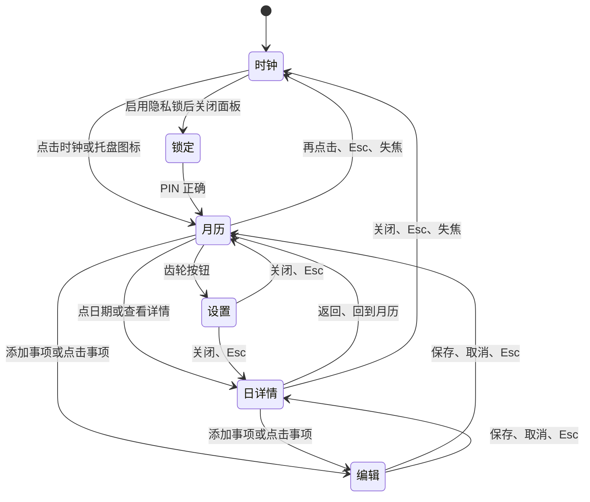

# 交互规范

本文规定窗口状态、操作行为、键盘、反馈和错误处理，行为以原型 [app.js](prototype/app.js) 为准。视觉标准见 [UI 规范](ui-spec.md)，界面图与验收见 [界面与交互](ui-interactions.md)，字段见 [模块配置](configuration.md)。

## 交互原则

1. **一个入口，一块面板**。点击任务栏原时钟打开月历，选日期、看黄历、管事项都在同一块面板里完成。
2. **先预览再提交**。时钟样式先改草稿和预览，点「应用样式」才更新任务栏；其余开关类设置即时生效。
3. **可逆与可退**。Esc 总是返回上一层；取消保留原数据；删除前确认。
4. **保持位置**。翻月、返回、保存后保留选中日期和滚动位置。
5. **错误可见且不丢数据**。校验失败给出文字原因，并保留输入。

## 窗口状态

窗口分五类：任务栏时钟（无面板）、月历、日详情、事项编辑、设置（四个页面）。模态对话框覆盖在任意一个之上。

- 编辑从哪来回哪去：从月历进入返回月历，从详情进入返回详情。
- 设置返回进入时所在的月历或详情；当前没有来源时回月历。
- 编辑中点击任务栏时钟或托盘不关闭面板，显示「请先保存或取消当前编辑」。
- 设置、月历同时存在时，由「关闭日历时同时关闭其他窗口」决定：开启则一起关闭，关闭则收起月历后仍留下设置窗口。

## 任务栏入口

| 操作 | 结果 |
| --- | --- |
| 左键点击原时钟位置 | 打开月历；月历或详情已开则收起 |
| 悬停 | 保持桌面状态，无额外弹层 |
| 点击辅助托盘图标（需在软件设置开启） | 与点击时钟一致 |
| 窗口失焦，或点击桌面空白 | 「失去焦点自动关闭日历窗口」开启且在月历或详情页时收起 |
| 拖动月历顶部（时钟区）或详情标题行 | 移动窗口；开启「记忆上次日历位置」后下次沿用，否则下次回默认位置 |
| 拖动月历边缘或角 | Windows 支持四边和四角，原型使用左上角、右下角。窗口大小受工作区限制，月历与日详情字号随尺寸变化。 |

月历主体整页显示。当前运行期间，切换月历与日详情、收起后重开都会沿用上次调整的大小。原型可将焦点移到角标，再用方向键调整。

## 月历

### 导航

| 操作 | 行为 |
| --- | --- |
| 点击日期格 | 选中该日并进入日详情 |
| 「今天」 | 选中今天并回到当月，不进入详情 |
| 上 / 下个月 | 整月翻页，选中日保持日号，超出月末取月末 |
| 鼠标滚轮（在日期网格上） | 逐周移动 |
| 可翻范围 | 2026-01 至 2027-12，边界的翻月按钮禁用 |

滚轮累计滚动超过 40 才触发，每满 80 多走一周，单次最多 3 周。开启「滚动后对齐月份」后，停止滚动 230 毫秒自动回到整月布局。

### 键盘

| 按键 | 行为 |
| --- | --- |
| Tab | 进入日期网格后只停在当前选中日，再按 Tab 离开网格 |
| ← → | 前一天、后一天 |
| ↑ ↓ | 前一周、后一周 |
| Enter / 空格 | 打开选中日的详情 |
| Esc | 关闭月历 |

方向键跨月时自动翻到相邻月，焦点跟随选中日；超出可翻范围时不移动。

### 周号与布局

- 「显示周数」开启时，周号为 ISO 周号；设置了日期范围时只在与范围相交的周行显示。
- 修改「一周开始于」仅重排七列，不改变周号。
- 「显示非当前月日期」关闭时，邻月格留空，仍保持占位。

### 今日安排

显示选中日的前两条事项。点击事项行进入编辑；点击待办复选框直接完成或恢复，不进入编辑。无事项时显示「当天还没有安排」。

## 日详情

- 顶部为日期卡、完整日期、星期、周号，以及节日、节气、放假或调休上班标签。
- 黄历区显示农历、干支和宜忌，缺项用「—」。
- 「日程与待办」列出当日全部事项，行为同月历。
- 返回箭头、「回到月历」和 Esc 的行为不同：前两者回月历，Esc 关闭面板。

## 事项编辑

### 字段与默认值

| 字段 | 规则 |
| --- | --- |
| 类型 | 日程或待办；默认日程 |
| 名称 | 必填，最长 100 |
| 日历分类 | 默认、工作、个人 |
| 日期 | 必填，范围 2026-01-01 至 2027-12-31，默认当前选中日 |
| 时间 | 默认 09:00；勾选「全天」后禁用并清空 |
| 重复 | 不重复、每天、每周 |
| 提醒 | 不提醒、到点、提前 10 分钟、提前 30 分钟；全天事项以 09:00 为基准 |

### 流程

1. 打开编辑后焦点落在「名称」。
2. 保存时先校验：名称为空显示「请填写事项名称」，焦点回到名称；日期缺失或越界由控件提示。
3. 保存成功后返回来源页，并显示「事项已保存」。编辑已有事项时，若修改后仍发生在当前选中日则保持选中，否则跳到事项日期。
4. 取消、返回箭头、关闭按钮和 Esc 都放弃草稿，原事项不变。
5. 编辑重复事项时提示「编辑将应用于整个重复系列」。
6. 删除：点击左下角「删除」弹出确认；重复事项提示会删除整个系列；确认框默认焦点在「取消」。删除后返回来源页并显示「事项已删除」。

### 待办完成

- 只记录当前选中日的完成状态；重复待办完成一天不影响其他日。
- 勾选后文字加删除线，焦点留在复选框；「待办完成提示音」开启时播放所选提示音。
- 编辑待办时，已完成记录只保留仍然发生的日期。

## 设置窗口

设置共四页，另有「城市与天气」对话框。窗口标题固定为「设置」，页面标题和导航一致。

### 提交模式

| 页面 | 模式 | 说明 |
| --- | --- | --- |
| 软件设置 | 即时 | 开关切换立即生效；整行文字可点击 |
| 日历设置 | 即时 | 开关、下拉、配色卡切换后月历立即变化 |
| 任务栏时钟 | 草稿加应用 | 选卡片或改格式只更新预览，点「应用样式」才提交 |
| 节日管理 | 开关即时，增改删在对话框内提交 | 开关切换同步月历、详情和时钟 |

### 软件设置

- **隐私锁**：启用开关打开设置 PIN 对话框（4–8 位数字，两次一致）；关闭需要验证现有 PIN。开启后「立即锁定」出现在开关左侧。
- **锁定态**：任务栏时钟只显示短时间和日期；点击后要求 PIN，验证通过进入刚才的目标页面，错误 PIN 保持锁定并选中输入框。
- **随系统自动运行**与**托盘图标**：原型只模拟状态，不写启动项。
- **待办完成提示音**：「声音设置」可选音色、调音量、试听。

### 日历设置

- 「显示周数」旁的链接打开日期范围表单；开始日期晚于结束日期显示「结束日期需等于或晚于开始日期」，不提交；「显示全年周数」清除范围。
- 「试建命令行示例日程」展示将执行的命令，确认后按默认分类创建一条事项。
- 日程内容的两张预览卡切换月历与详情中日程行的浅色或实色样式。

### 任务栏时钟

- 九种预设和「自定义格式」互斥。在上下行输入框里键入内容自动切到自定义。
- 每次打开时用「示例日期」展示九张卡片的完整两行。切到「当前时间」后逐秒更新文字，保留已选样式、键盘焦点和格式草稿。底部预览始终取当前时间。Windows 版可在月历齿轮打开独立设置窗口，再次启动 EXE 会激活现有窗口。
- 格式为空或字段非法时：预览显示「—」，错误文字显示在下方，「应用样式」禁用，任务栏保持旧样式。
- 选「节日倒数」时出现「倒数节日」下拉，只列已启用节日。
- 「格式说明」对话框列出字段与示例。

### 节日管理

- 三栏：公历、农历、动态。搜索匹配名称和别名，无匹配时提示换名称或新增。
- 内置节日只能开关；自定义节日可编辑、删除。
- 停用某节日后：所有展示该名称的区域同步更新，休班标记仍按官方年度数据；若它是倒数目标，则清空目标。
- 新增或编辑：名称必填，不得与其他节日同名；规则切到「动态」时显示「顺序」和「星期」，隐藏「日期」；农历日期最大 30。
- 删除前确认；在确认框取消会回到该节日的编辑表单。

### 城市与天气

演示城市下拉切换后，月历天气区、任务栏天气字段随之更新。「离线有缓存」显示缓存时间；「离线无缓存」显示「暂无数据」，并保留美标 AQI 口径说明。

桌面版可输入「深圳」或「深圳市」，按回车搜索，选中行政区匹配的结果后应用。系统代理连接失败时，搜索框下方显示重新连接的方法。「直连天气服务」立即用于本次搜索，应用后也用于后台刷新。月历分别显示气温和美标 AQI 的数据时间，一项仍在查询时可先查看另一项。离线原型中的直连开关仅模拟选择。

## 键盘与焦点

| 场景 | 规则 |
| --- | --- |
| Esc | 有对话框时先关对话框；否则编辑返回来源、设置返回月历或详情、月历或详情关闭面板；隐私锁启用时关闭即锁定 |
| 打开编辑 | 焦点到「名称」 |
| 打开对话框 | 有输入框的表单落在指定的第一个输入框，其余信息类对话框落在第一个可聚焦控件；破坏性确认落在「取消」 |
| 重绘后 | 焦点回到刚操作的控件（开关、卡片、日期格、复选框） |
| 切换页面 | 焦点到窗口容器，由 Tab 进入内容 |
| 关闭面板 | 焦点回任务栏时钟 |

所有焦点变化都不得让窗口滚动跳动。

## 反馈、空状态与错误

| 类型 | 表现 |
| --- | --- |
| 成功 | 任务栏上方提示条停留 2.2 秒：「事项已保存」「事项已删除」「节日已保存」「已应用到任务栏时钟」等 |
| 校验错误 | 表单内红色文字加焦点回到出错控件，数据不丢 |
| 空列表 | 事项为空显示「当天还没有安排」；节日无匹配提示换名称搜索或新增 |
| 天气不可用 | 显示「暂无数据」或缓存时间，不影响月历操作 |
| 浏览器限制 | 无法完成本地 PIN 校验或播放声音时给出原因提示 |
| 任务栏时钟长内容 | 按原位置的宽高折行和缩字，上下行内容同时可见 |

## 验收清单

1. 从时钟打开月历，用键盘完成「选日期 → 添加待办 → 保存 → 勾选完成 → Esc」。
2. 编辑重复事项，确认出现整个系列提示；删除时默认焦点在「取消」。
3. 在设置里分别触发：空标题、非法时钟字段、范围起止颠倒、错误 PIN，各出现可读文字且数据不变。
4. 停用感恩节，月历、详情和「节日节气」时钟同步变化；2026-10-10 仍显示「班」。
5. 选 11 月 23 至 29 日周数范围，周一开头仅第 48 周显示周号；切周日开头与邻月日期复查。
6. 切换窄时钟，确认自定义时间、日期和附加信息同时显示。桌面版检查任务栏收放及鼠标移开时的覆盖层。
7. 启用隐私锁后关闭面板，时钟只显示短时间与日期；输入正确 PIN 才可进入。
8. 浅色、深色、高对比度及减弱动效下各过一遍上述路径，焦点环始终可见。

## 变更约定

增加或修改交互时，同时更新本文、`prototype/app.js`，并在 [界面与交互](ui-interactions.md) 的状态表和验收步骤中保持一致。
