# 界面与交互

## 截图工具

从月历底栏的「截图工具」选「开始截图」。拖选或点选窗口后，可标注、复制、保存、钉住或识别。贴图可拖动、缩放或按空格继续标注。文字面板支持逐段校对、复制和翻译，手动粘贴可直接从菜单进入。快捷键和模型接口在「截图与翻译」设置中调整。

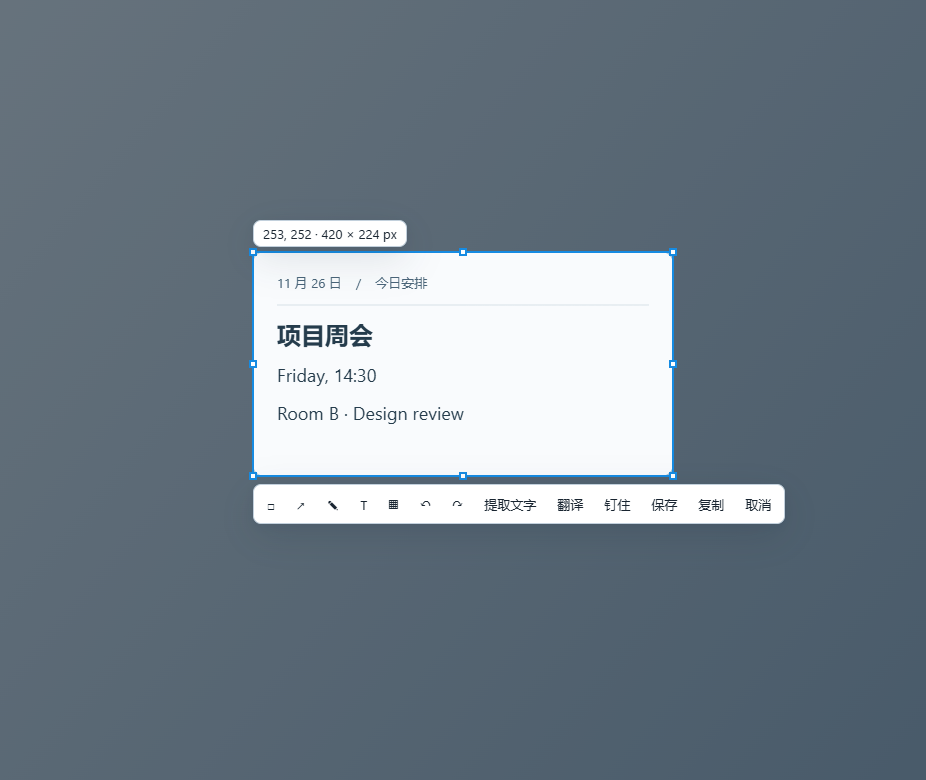

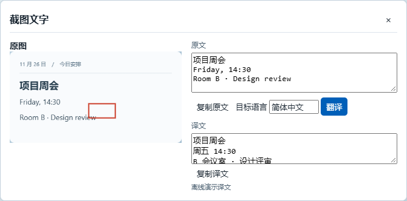

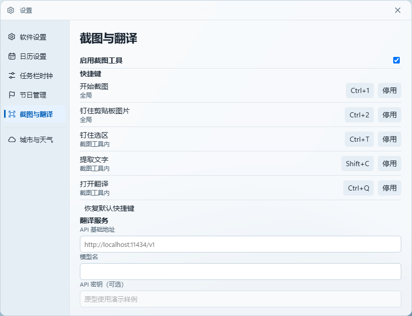

原型使用离线示例画面和标明来源的演示文字。桌面版从实际屏幕、剪贴板和用户配置的模型读取结果。交互参考 [PixPin 截图](https://pixpin.com/docs/screenshot/basics)、[贴图](https://pixpin.com/docs/pin/basics)、[标注](https://pixpin.com/docs/annotation/basics) 与 [文字提取](https://pixpin.com/docs/recognition/text-recognition)。

这套原型围绕一次桌面操作设计：点时间打开月历，选日期看当天事项，需要调整时再开设置窗口。以下八张图均由同一套离线 HTML 渲染。左侧原型导航和演示环境用于评审，正式桌面窗口采用图中实际面板的布局。[打开可点原型](prototype/index.html) · [模块配置](configuration.md)

## Windows 11 紧凑视觉规范

色彩令牌、字号、尺寸、组件状态和无障碍要求见 [UI 规范](ui-spec.md)，窗口状态、键盘和操作流程见 [交互规范](interaction-spec.md)。本文只记录界面图、操作与业务状态的对应关系和验收步骤。

官网 Windows 系统日历图提供了顶部时间和天气、下方七列月历的布局参考；任务栏图用于确定双行时钟与相邻系统图标的关系。官网独立日程月视图中的分类色与时间标签用于安排列表。九宫格预设、节日管理、日历设置和软件设置则依据用户提供的设置截图重绘。原型自绘所有界面，无广告预留位。[Windows 月历参考](https://www.yxcal.com/images/feature-win-calendar.webp?v=20260429) · [任务栏时钟参考](https://www.yxcal.com/images/feature-win-taskbar-clock.webp?v=20260429) · [日程月视图参考](https://www.yxcal.com/images/feature-schedule-macos.webp?v=20260429)

## 从任务栏到当天事项

### 1. 任务栏时钟

时钟放在系统原位置。上下行同时显示，空间不足时自动缩小并折行。悬停保持桌面状态。点击时钟打开月历，再点收起；可选的辅助托盘图标使用同一入口。

### 2. 月历弹窗

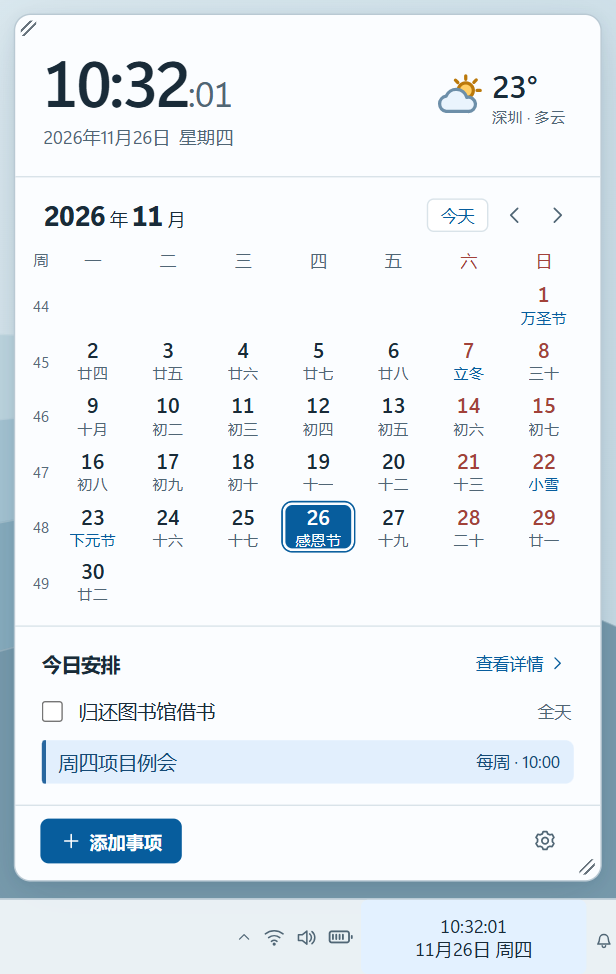

拖动左上角或右下角可以改变大小。上方时间、日期格和下方安排随窗口缩放。月历整页可见，翻月箭头按整月导航，日期格上仍可用滚轮逐周移动。「今天」恢复固定演示日期。点击日期格在左边打开详情，再点同一天收起。直接点击某条事项进入编辑。上部天气按钮可选演示城市并查看高低温、美标 AQI 和更新时间。月历下部展示最前两条安排，其余通过「查看详情」进入完整列表。

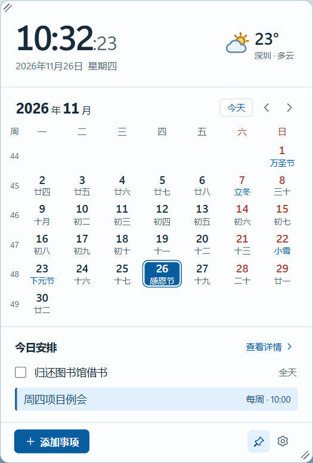

Windows 月历打开时显示在应用窗口前方，日详情与月历一起显示。未固定时，指针连续离开两窗 5 秒或点击窗外可自动收起。图钉亮起时暂停自动收起。

### 3. 当日详情

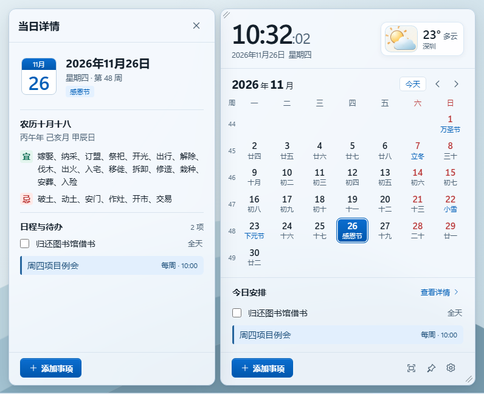

固定示例为 2026 年 11 月 26 日星期四、农历十月十八。日程显示为带分类色左边的整行色块，与「日历设置」中的配色预览一致。待办可直接勾选，重复待办只完成当前发生日。点另一天时左侧内容直接更新，点关闭按钮或按 Esc 时保留月历和选中日期。

### 4. 事项编辑

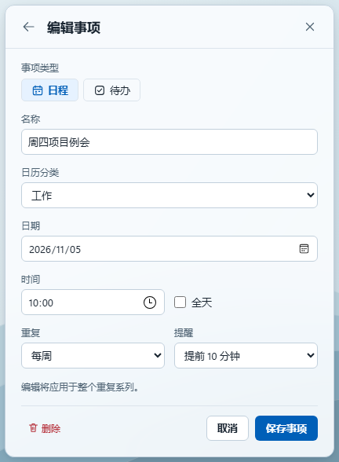

支持日程或待办、分类、标题、日期、全天、重复与提前提醒。保存时校验标题和日期，返回原列表。编辑重复事项时说明修改作用于整个系列；左下角「删除」带文字，删除前确认。取消草稿保留原事项。浏览器保存到演示会话，实际文件提交和到点提醒需在桌面版本验证。

### 快捷日期提醒

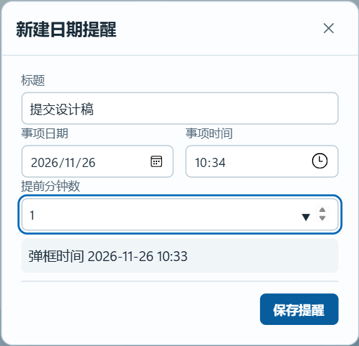　

右键日期选择「新建提醒…」，填写事项时间和提前量。日期格小圆点表示当天有提醒，再次右键可以编辑。原型按演示时钟弹出消息，Windows 版按本机时间弹出。

## 设置窗口

### 5. 九种时钟样式

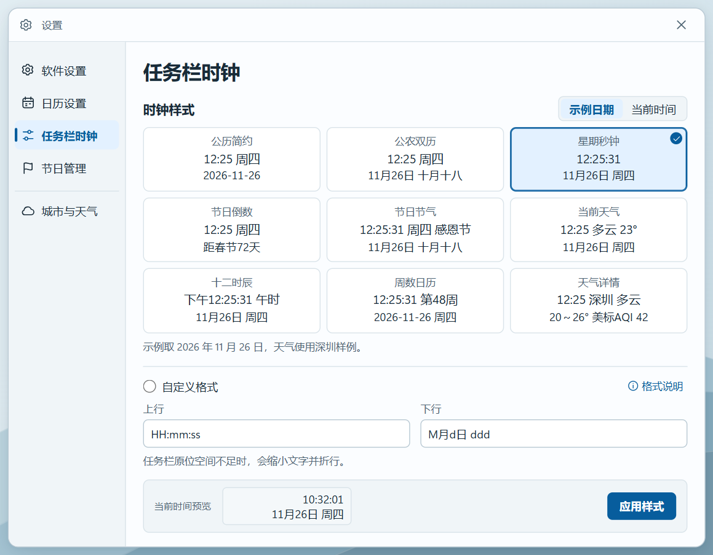

每张卡片从上到下显示样式名、时钟上行和下行。「示例日期」用同一时刻和深圳天气样例比较九种排版。「当前时间」展示当前数据下的效果。底部始终预览当前所选样式，编辑任一行即进入自定义模式。选择「节日倒数」可指定已启用的目标节日。

浏览器原型点击「应用样式」提交。Windows 版从月历齿轮打开可调整大小的独立设置窗口，点击「应用设置」保存并返回月历。有格式错误时显示原因。[预设清单与格式字段](configuration.md#九种时钟预设) · [Windows 实机界面](windows.md#选择任务栏时钟样式)

### 6. 节日管理

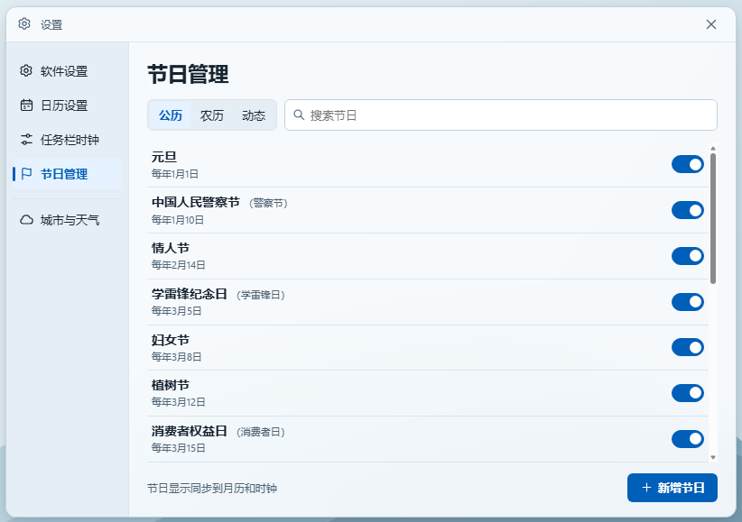

可按名称、别名搜索。内置节日可开关，自定义节日可增删改。停用某个节日后重新计算展示该名称的所有区域，仍按官方年度数据标记休班。「动态」支持某月第几个或最后一个星期几。

### 7. 日历设置

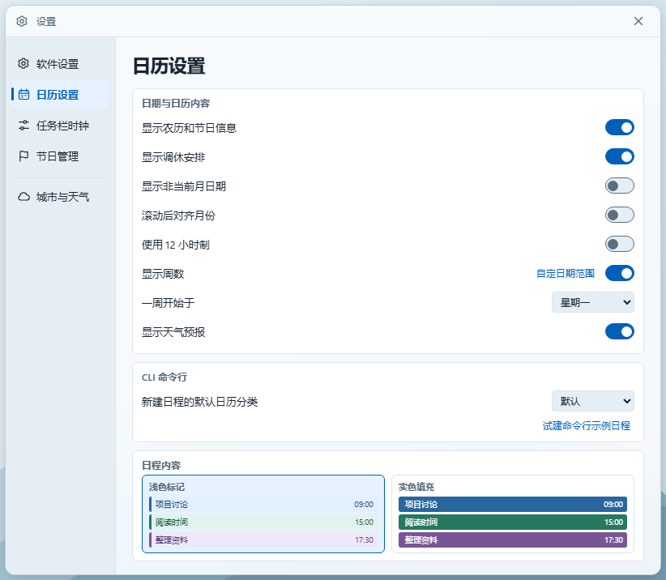

这里决定月历实际显示的内容。切换农历、调休和邻月日期后可回月历核对。修改一周开始日会重排七列；自定起止日期只是 ISO 周号的显示条件。滚动后对齐、12 小时制和天气均可独立设置。下方可试建采用默认分类的命令行日程，并在浅色或实色样式下查看结果。

### 8. 软件设置

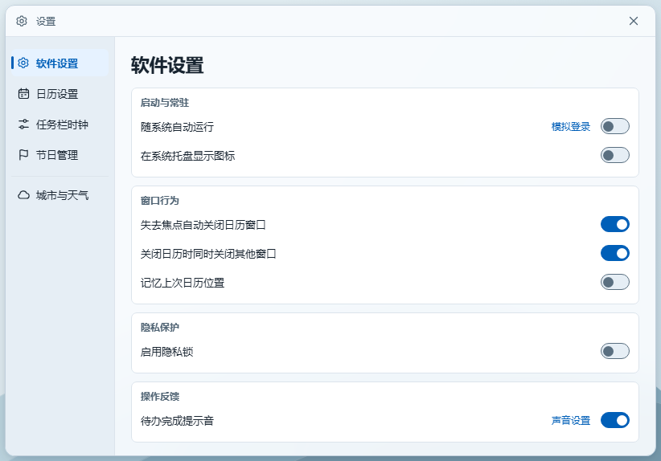

原型可模拟登录、显示辅助托盘、拖动月历顶部并记忆位置、控制外部点击收起和关联窗口。启用隐私锁后，可先立即锁定，再从时间入口输入本次演示 PIN 解锁。在「声音设置」中选择音色、调节音量及试听。真实启动注册和 Windows 身份验证另列为桌面验收项。

## 界面动作如何改变状态

| 动作 | 读取或提交 | 用户看到的结果 |
| --- | --- | --- |
| 点击时钟、移开指针、点击窗外 | 读取图钉状态、关闭策略和锁状态 | 打开月历、自动收起或保持固定。锁定时先要求解锁。 |
| 切月、选日期 | 用选中日期查询历法、节日、休班与事项 | 日期格和详情一致，返回时保留选择。 |
| 停用感恩节 | 更新启用规则集合，重新推导日期内容与格式字段 | 对应月历格、当天详情、时钟节日字段同步更新。 |
| 应用时钟模板 | 验证字段并提交两行格式，测量可用宽高 | 保存后更新任务栏，两行内容按可用空间折行。 |
| 新增事项、勾为完成 | 更新系列与当前发生日状态 | 原日期能看见新增项，完成后带勾和删除线；设置允许时播放完成音。 |
| 修改周数区间 | 校验 `from ≤ to`，以包含端点的区间过滤已有 ISO 周号 | 默认周一开头，11 月 23 至 29 日显示 48；范围外留空。 |
| 切换离线状态 | 有缓存时读取原城市样例及数据时间，无缓存时返回明确缺失状态 | 月历照常响应，天气区域显示缓存时间或「暂无数据」，空气质量保留美标口径。 |

## 验收与重新导图

- **离线交互**。从 `file://` 入口打开，禁用网络；实际操作选日、八个页面、九种样式、添加事项、勾选待办、节日开关、PIN 锁和声音设置。原型的正常路径不需要 HTTP 请求。
- **历法与配置**。核对十月十八、ISO 第 48 周、感恩节，以及 2026-10-10 的补班。设置 11-23 至 11-29 后验证月历和详情，检查 「周数日历」 超出区间时不显示周号。用周日开头、邻月日期和逐周滚动检验布局边界。
- **输入与恢复**。用空标题、非法时钟字段、结束日期早于起始日期、错误 PIN 各试一次。取消时保留原设置；错误 PIN 保持锁定；断网有缓存与无缓存的状态能明确区分。
- **重新导图**。在 1130 × 780 的浅色桌面视口重载原型，较长的日历设置页扩展到 860 高，确保状态提示已消失。按八个界面顺序导出：第一张保留任务栏右端，第二张同时保留月历和时钟，其余截取各自窗口。编辑图选中「周四项目例会」。以相同文件名替换 `prototype/screens` 中的 PNG，并复查深色和窄窗口排版。
- **周号回归**。在仓库根目录运行 `node --test docs/prototype/tests/week-range.test.cjs`，可重复验证周一、周日起始日的区间边缘，以及跨年与时钟字段的显示。
- **桌面真机另验**。在 Windows 11 25H2 x64 上依次验证原时钟接管与退出恢复、任务栏自动隐藏及 DPI、当前用户登录启动与实际托盘图标、系统身份校验、文件保存读回、真实天气，以及睡眠唤醒后的提醒去重。按约定临时退出优效再测试，测完恢复。
