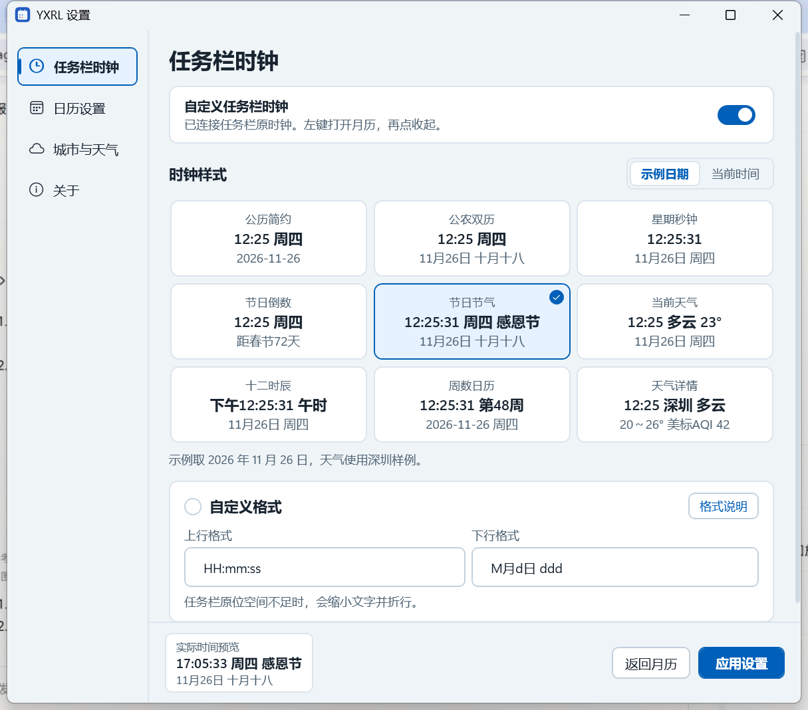

# Windows 桌面试用版

在 Windows 11 x64 上双击 `dist/win-x64/Yxrl.exe`。它包含 .NET 桌面运行时，以普通用户身份运行。首次解包运行时可能需要几秒。原时间位置已由优效接管时，请先从优效菜单正常退出。若任务栏自动隐藏，将鼠标移到屏幕边缘，系统任务栏展开后即可看到两行时钟。

## 在任务栏使用

- 左键点击时间，月历会在当前应用窗口前方打开，再点一次或按 Esc 收起。未固定时，鼠标连续离开月历和左侧日详情 5 秒会收起。开启「点击月历外自动收起」时，点击两窗之外也会收起。
- 点击右下角齿轮旁的图钉，月历和左侧日详情会持续显示。再次点击恢复自动收起。固定状态在本次运行期间保留，右键日期菜单、提醒编辑和拖动尺寸时会暂停自动收起。
- 拖动月历的边缘或角来调整窗口大小。时间、日期格和天气字号随可用宽高缩放，六周月份也能整页显示。同一次运行中，收起再打开会沿用调过的尺寸。
- 点击日期，在月历左侧查看农历、干支、节日、节气和当日宜忌。也可点月历右下摘要卡旁的「详情 ›」展开或收起。再次点击同一天、按 Esc 或点详情的关闭按钮即可收起。点另一天直接切换内容。左右翻月，「今天」回到系统日期。方向键选日，Page Up / Page Down 翻月，Home 回到今天。
- 右键日期并点「新建提醒…」，可以为该日期添加一次性弹框提醒。键盘可先选日期，再按 Shift+F10。
- 点月历右下角齿轮打开独立的设置窗口。再次双击 EXE 也会进入同一个窗口。任务栏原位置会按可用宽高自动缩字、折行，同时显示两行格式的内容。
- 「日历设置」可设置农历、休班、邻月日期、12 小时制、周首日和 ISO 周号范围。范围包含起止两天，范围内保留原周号。中国休班数据覆盖 2026、2027 两年，普通周末以颜色标出。
- 首次使用天气时，点月历右上角玻璃天气卡（或设置中的「城市与天气」），输入城市名，按回车搜索，选择城市后点「应用设置」。如果搜索提示系统代理连接失败，勾选「直连天气服务」后重新搜索。天气卡显示当前气温、天气现象、美标 AQI 和观测时间。
- 月历的玻璃天气图标随实况和城市日照变化（晴天太阳、日出日落、晴夜、雨滴下落、雷雨、下雪等），悬停可查看气温范围、美标 AQI 及同日日出日落时刻，界面不展示数据来源信息。
- 「关于」中的「退出日历」释放任务栏位置，Windows 原时钟随即恢复。启动项由用户自己的 Windows 设置管理，试用版默认手动启动。

时钟和月历偏好保存在 `%LOCALAPPDATA%\Yxrl\settings.json`。天气缓存为同一目录的 `weather-cache.json`。当配置无法读取时，设置页显示路径与错误并保留原文件。试用版支持日期提醒。日程、待办、节日管理编辑器及软件设置的完整体验可在[交互原型](prototype/index.html)中查看。

0.2.1 会跟随任务栏收放，并复用已经识别的原时钟位置。首次启动时，Windows 展开系统任务栏后会识别一次原时间控件。自定义可试用上行 `HH:mm:ss ddd {节日}`、下行 `M月d日 {农历} 第{周数}周`，任务栏按空格优先折行，内容越长会使用越小的字号。

## 截图、贴图、录屏和翻译

按 **Ctrl+1** 冻结桌面。拖选矩形或点选窗口，拖动手柄调整边界。工具栏提供矩形、椭圆、箭头、线段、画笔、荧光笔、文字、序号和马赛克。按 Ctrl+Z 撤销、Ctrl+Y 重做、Enter 复制，或点「保存」导出原尺寸 PNG。

| 操作 | 默认快捷键 | 可以在哪里用 |
| --- | --- | --- |
| 开始截图 | Ctrl+1 | 桌面任意应用 |
| 钉住剪贴板图片 | Ctrl+2 | 桌面任意应用，剪贴板中需有图片 |
| 钉住当前截图 | Ctrl+T | 已选定的截图区域 |
| 录制屏幕 | G | 已选定的截图区域 |
| 滚动长截图 | L | 已选定的截图区域 |
| 添加连续序号 | Shift+4 | 截图选区或贴图标注模式 |
| 添加文字 | Shift+8 | 截图选区或贴图标注模式 |
| 提取文字 | Shift+C | 截图选区或贴图 |
| 打开翻译 | Ctrl+Q | 截图选区或贴图 |

剪贴板同时提供 PNG 和 Windows 位图时，Ctrl+2 优先读取原始 PNG，贴图与导出均保留它的颜色和透明度。只有位图时也可钉住图片。

贴图可同时打开多张，拖动移动，滚轮缩放，空格切换标注，Esc 关闭当前图。月历底栏的「截图工具」也提供鼠标入口。到「设置 → 截图与翻译」可修改或逐项停用快捷键，关闭总开关会释放全局快捷键。点「应用设置」生效。

点「序号」后在画面依次单击，得到 1、2、3。选择已有编号可改数值或拖动，双击可写说明。点击「文字」后在画面放置文字，Enter 换行，Ctrl+Enter 提交，双击已有文字继续编辑。

长截图选中会滚动的内容后按 L。按纵向向下或横向向右滚动，保留两屏重叠，点「完成长截图」得到置顶长图。录屏从选区按 G 开始配置。停止后可回放、剪头尾、裁画面、调倍速，再另存 MP4、GIF 或 WebP。快速模式在录制前选路径，停止后直接保存 MP4。[截图和录屏操作](capture-recording.md)

录屏可开启摄像头叠加、鼠标点击和快捷键动画。系统声音、麦克风可同时录制，在「录屏回放 → 音轨与动画」各自调音量或静音。应用异常退出后，下次启动可恢复已封存片段。录制中未封存的结尾通常在三秒以内。

文字提取使用随 EXE 提供的中英文 PP-OCRv5 mobile 小模型。首次使用会在当前用户的 Yxrl 数据目录解包模型，可离线识别。识别面板保留原图和可编辑的原文，马赛克区域在识别前会遮盖。

要翻译，先在同一设置页填写 OpenAI 兼容服务的 API 基础地址和模型名。可选密钥存入当前用户的 Windows 凭据管理器。在原文中选择一段文字或保留全文，选择目标语言，点击「翻译」后发送这段文字。也可从月历的「截图工具 → 粘贴文字翻译」直接输入或粘贴原文。

## 右键日期创建提醒

1. 在月历中右键目标日期，点「新建提醒…」。表单会带入该日期。
2. 填写标题、事项时间和提前分钟数，可以输入自定值。填 0 表示到点提醒。比如事项时间为 16:40，提前 30 分钟，表单会预览 16:10 弹框。
3. 保存后，日期格左下角会出现小圆点。右键同一天，进入「已有提醒」可以查看、改期或删除。

YXRL 在运行期间会按设定时间弹框，月历可以收起。同一时间到期的提醒会合并。睡眠期间或程序退出期间错过的提醒会在唤醒或重新启动 YXRL 后补发，已经提醒的记录会被记住。提醒数据保存在 `%LOCALAPPDATA%\Yxrl\reminders.json`。

在本机实测设定 16:12 的事项并提前 1 分钟，收起月历后于 16:11 弹框。关闭弹框后，从本地文件读回了送达收据，随后删除了测试提醒。


## 选择任务栏时钟样式

0.2.0 的设置窗口可拖动、缩放和最大化。左侧选择「任务栏时钟」，右侧九张卡片分别显示名称和任务栏的完整上下两行。选中卡片有描边和对勾。缩窄窗口后，导航移到顶部，卡片按可用宽度重新排列。

- **示例日期**统一使用 2026 年 11 月 26 日 12:25:31。可以并排看到公历日期、农历十月十八、感恩节、距春节天数和第 48 周。天气卡使用已注明的深圳样例。
- **当前时间**使用电脑时间、自己启用的节日和所选城市的数据。底部的「实际时间预览」始终显示所选样式在本机此刻的两行内容。
- **自定义格式**支持直接编辑上下行。例如上行填 `HH:mm:ss`、下行填 `ddd {农历}`。「格式说明」可查字段及示例。输入有误时界面显示原因，修正后即可应用。
- 点「应用设置」保存并回到月历。「返回月历」或 Esc 可放弃本次调整。旧版保存的样式和自定义格式会自动读回。



## 本机验收

本轮「录制范围框」更新完成 `dist/win-x64/Yxrl.exe`（`99,574,327` 字节）单文件发布与多项实测校验：`RecordingRegionFrame` 真实 WPF 透明置顶窗口在 Windows 11 实机上确认已生效 `WS_EX_TRANSPARENT | WS_EX_TOOLWINDOW | WS_EX_NOACTIVATE` 与 DWM `WDA_EXCLUDEFROMCAPTURE`（`CaptureExcluded == true`），`CalculateBounds` 四场景外扩/钳位逻辑、`Countdown`/`Live`/`Paused`/`Ready` 状态切换、控制窗退出同步销毁零残留及 `RenderTargetBitmap` 离屏红色边界与中心全透明检查全部通过；`RecordingChecks` H.264/AAC/GIF/WebP 编码与中断恢复及无头 Edge 离线原型（`ready`/`live`/`paused`/回放隐藏及导出 `17-recording.png`，`2026-11-26` 感恩节、`2026-10-10` 补班）零报错通过。因验证末尾 Windows 会话处于锁屏状态，解锁后的真实 GDI 桌面实录叠加 `WDA_EXCLUDEFROMCAPTURE` 边角无污染像素回读（`--ocr --capture-windows --recording`）待桌面解锁后复验。

本轮截图、贴图与 OCR 交互完善在 Windows 11 25H2 x64（150% 缩放，DPI 144）完成单文件 `dist/win-x64/Yxrl.exe`（`99,568,695` 字节）真机复验：启动 `--settings` 打开 Mica「截图与翻译」页，分组卡片、「全局」/「工具内」范围徽章、`Ctrl+3` 恢复贴图快捷键及「测试连接」按钮渲染与 UIA 校验通过；在真实桌面及微软拼音环境下，按下全局热键 `Ctrl+2` 从剪贴板钉住「YXRL 桌面贴图」（无虚线焦点框），`Shift+C` 唤起随包 PP-OCRv5「YXRL 提取文字」窗口并读回「项目会议 14:30 / Room B · Design review / YXRL Real Desktop Pin & OCR」与左图包围盒标注，关闭后按 `Ctrl+3` 恢复已关闭贴图，`Ctrl+1` 框选真实屏幕 `560 × 260 px` 并显示 `SurfaceGlass` 玻璃工具栏。`Yxrl.Checks --ocr --capture-windows` 在真实 GDI 桌面（`545 × 170 px`）全数通过，`node --test` 与无头 Edge 离线原型（含 `2026-11-26` 感恩节、`2026-10-10` 补班与导出图 12–16）零报错通过。

0.5.0 在 Windows 桌面同时录制系统声音和麦克风阵列，分别试验混音、系统声音 35% 且麦克风静音、麦克风 45% 且系统声音静音。三份 584 × 286 的 H.264/AAC MP4 均在 Windows 播放到结束，解码后的两路增益与所选音量一致。摄像头实机读帧并合成通过。中断验收在第二段写入时直接退出测试进程，随后从第一段读回 72 帧。

0.4.0 在 Windows 桌面捕获公开测试窗口，读回 544 × 170 的 MP4、暂停前后的画面和系统测试音。原生保存对话框的快速 MP4 直存通过，长截图把 545 × 170 的窗口拼成 545 × 226 的置顶长图。编码回归覆盖裁画面、倍速以及 GIF、WebP 的帧数和尺寸。

0.3.0 在 Windows 11 25H2 x64 上验证了月历的截图工具菜单、设置改键与停用、全局热键冲突回滚、原像素 PNG 回读，以及选区、置顶贴图和文字窗口。给 WPF 选区输入 560 × 130 的公开样例，随包 OCR 读出「项目会议 14:30」和「Room B Design review」。对 1314 × 1089 的 PixPin 参考图，OCR 返回 483 个字符，包含 screenshot 和 toolbar。临时本机 Qwen2.5-0.5B-Instruct 实际收到选中的英文句子，返回「会议从下午2点开始。」。11 月 26 日的感恩节、10 月 10 日的补班和离线原型回归均通过。

发布目录内只有 Yxrl.exe。单文件从该目录启动并向已有实例转交设置请求，退出码为 0。从该 EXE 取出的应用、模型和推理库也在干净的临时目录通过了上述 OCR 和翻译用例。

本次 Windows 会话锁屏，真实桌面取像、从系统剪贴板钉图和实际按下全局快捷键仍待解锁复验。负坐标和 100%／150% 缩放下的选区像素尺寸已用自动化用例验证，当前会话只枚举到一台显示器。

0.2.7 用 Windows 最大化测试窗口复现了未固定月历被遮挡的问题。修复后，月历和日详情在测试窗口前方显示，取消固定后仍可操作，点击外部可一起收起。

本轮样式优化在 Windows 11 25H2、150% 缩放下完成真机复验：`CalendarWindow` 与 `DayDetailWindow` 启用 DWM Acrylic 与圆角玻璃质感且顶部无白条残留，`SettingsWindow` 启用 Mica 标题栏与侧栏分段卡片。月历右上角玻璃天气卡展示日落动态图标与「武汉 16° 晴 · AQI 130 · 16:45」，全部桌面界面已移除天气与城市数据源署名；点击天气卡直接打开设置并定位到「城市与天气」。月历与左侧日详情验证 `2026-11-26` 显示感恩节、`2026-10-10` 保留补班「班」标记，任务栏时钟样式页通过 `tests/check-clock-gallery.ps1` 全部 9 张样式卡无障碍检查。

0.2.6 在 150% 缩放下实测任务栏点击、日详情停留和移出收起。鼠标停在左侧日详情 5.2 秒，两窗继续显示，移出后约 5.04 秒一起收起。窗口测试用实际 WPF 控件验证图钉改变 Windows 置顶层级，以及窗口刚显示便能处理窗外点击。

0.2.5 在 Windows 11 25H2、150% 缩放下验证了月历的晴天、日出、日落、晴夜和降雨。雨滴随时间移动，收起月历后动画停止。最小尺寸下，天气和右侧的小字署名仍可阅读。主源和备用源均返回了可用的深圳日出、日落字段。

0.2.3 在 Windows 11 25H2、150% 缩放下验证了左侧详情。点 11 月 26 日显示感恩节，再点 26 日只收起详情。点另一天直接切换，10 月 10 日保留补班标记。两窗之间切换焦点时保持展开，焦点移出后一起收起。拖动月历边缘时详情跟随，窄工作区也能并排显示。

0.2.2 在 Windows 11 25H2、150% 缩放下检查了月历的四边和四角、工作区边界和重新打开后的尺寸。月历从默认 612 × 837 物理像素放大到 810 × 1095，也可缩到 510 × 675。最小尺寸下，六周日期、天气两行、来源及底部详情均在月历内显示。日详情与 2026 年 11 月 26 日的感恩节、10 月 10 日的补班标记一并回归。

0.2.1 在 Windows 11 25H2、150% 缩放、任务栏自动隐藏的环境下实测。鼠标停在原时钟左侧 134 像素处，两次收放均复用同一覆盖窗口，在系统任务栏停止移动后分别用 31 毫秒和 45 毫秒贴合原位。随后实际左键点击原位置，月历正常打开和收起。下图取自发布版在 115 × 72 像素内显示「节日节气」的效果。


Windows 11 25H2 x64（26200.7840），屏幕缩放 150%，任务栏自动隐藏。展开后，Explorer 的原时钟和 YXRL 窗口均位于物理像素 `(2939, 1848)`，宽 115、高 72。悬停保持收起，真实左键打开月历，再点收起。右键出现 Windows 的「调整日期和时间」「通知设置」，点击旁边的系统图标仍由 Windows 处理。

　

0.2.0 的发布 EXE 已在同机复测。实际左键点击原时钟中央 `(2996, 1884)` 打开月历，再通过齿轮打开独立设置。Windows 辅助功能树逐张读回了九组上下行。切到「当前时间」后秒数推进，再次启动 EXE 保留同一窗口和预览模式。「格式说明」、返回月历和重新进入设置均已验证。上方设置截图取自这个运行中的发布包。

在 0.1.0 的原位时钟验收中，查看了 11 月 26 日的感恩节、农历十月十八，以及 10 月 10 日的补班标记。将下行改为 `ddd {农历}`，退出进程后重新启动，预览读回「周四 十月十八」。当次验收结束后恢复了原先运行的优效，并确认两者同时启动时 YXRL 会提示原时间位置已被占用。

2026 年 11 月 26 日，在隔离的 Windows 设置窗口输入「深圳市」，选择「深圳 · 广东 中国」并应用直连。月历先显示 14:45 的阴、21°，随后显示 14:00 的美标 AQI 119。独立联网检查也从新建的服务实例读回了同一城市的缓存。另一次只让测试进程的主天气源连接失败，Visual Crossing 实际返回了 14:39 的多云、19° 和美标 AQI 120。

## 从源码生成同样的单文件

1. 取 `global.json` 指定的微软 .NET 10 SDK 的 **Windows x64 Binaries (zip)**。解包到仓库 `.tools/dotnet`，使其中直接包含 `dotnet.exe`。下载来源为[微软 .NET 10 下载页](https://dotnet.microsoft.com/en-us/download/dotnet/10.0)。
2. 在仓库根目录运行下列 PowerShell 命令。发布脚本按 NuGet 锁文件还原，生成自包含单文件。

```powershell
.\.tools\dotnet\dotnet.exe --version
.\scripts\publish.ps1
.\dist\win-x64\Yxrl.exe
```

开发者可单独运行历法、配置及双行格式回归。最后一条命令读取当前桌面已展开的原生时钟边界，供适配不同 Windows 构建时使用。

```powershell
.\.tools\dotnet\dotnet.exe run --project tests/Yxrl.Checks -c Release
.\.tools\dotnet\dotnet.exe run --project tests/Yxrl.Checks -c Release -- --ocr --capture-ui
.\.tools\dotnet\dotnet.exe run --project tests/Yxrl.Checks -c Release -- --capture-windows
.\.tools\dotnet\dotnet.exe run --project tests/Yxrl.Checks -c Release -- --recording
.\.tools\dotnet\dotnet.exe run --project tests/Yxrl.Checks -c Release -- --recording --capture-windows
.\.tools\dotnet\dotnet.exe run --project tests/Yxrl.Checks -c Release -- --weather --direct
node --test docs/prototype/tests/week-range.test.cjs tests/catalog-parity.test.cjs
.\.tools\dotnet\dotnet.exe run --project tests/Yxrl.Checks -c Release -- --taskbar
```

设置中的「开源许可」可查看历法库、OCR 模型和推理组件、图像处理库、.NET 运行时及 WPF 的随包许可。

检验双行样式时，先打开桌面版「任务栏时钟」设置，再运行 `./tests/check-clock-gallery.ps1`。脚本从 Windows 辅助功能树读取九张卡片，列出各自实际显示的上下行。
